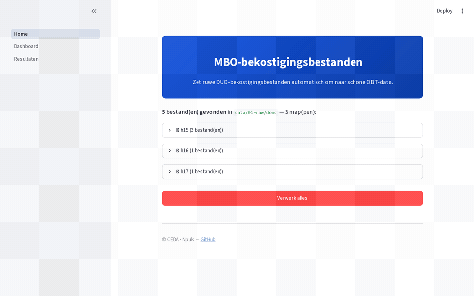
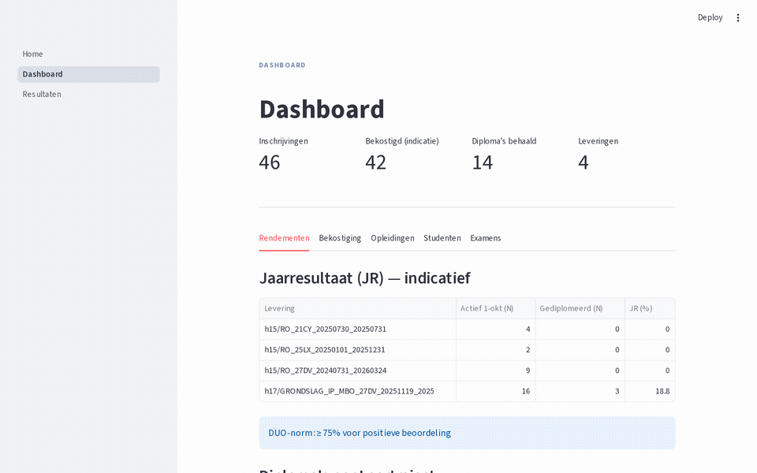
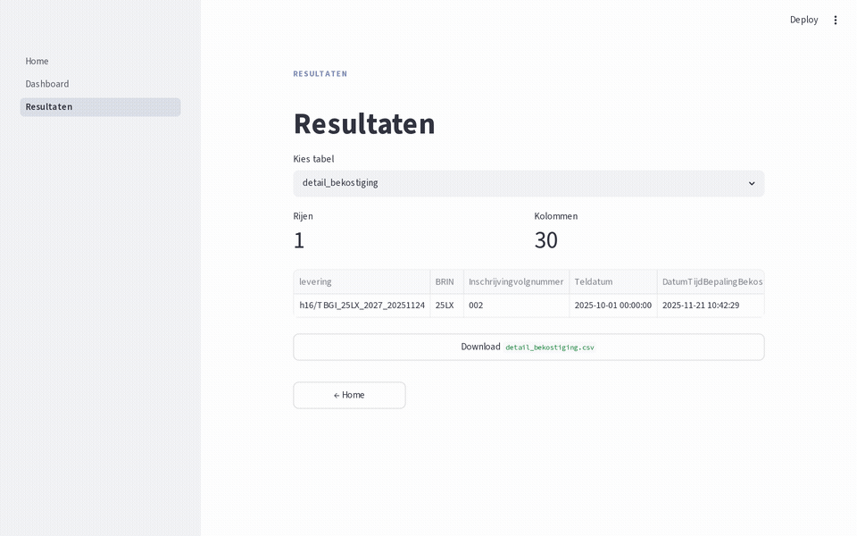

# De app gebruiken

De Streamlit-app verwerkt de bestanden, bouwt het analysemodel en toont de uitkomst. De app draait lokaal en wordt bewust niet gehost; zie [Privacy en pseudonimisering](../privacy.md). Starten staat in [Snel starten](../aan-de-slag.md#interactieve-app). Elke stap heeft een CLI-equivalent.

De zijbalk heeft vier pagina's: **Home**, **Werkbare data**, **Analysemodel** en **Dashboard**.

## Stap 1. Bestanden verwerken (Home)

Zet de ruwe bestanden in `data/01-raw/`. Op Home zie je de ontdekte bestanden. De twee producten zijn aparte stappen:

1. **Verwerk bestanden** maakt de [brondata](brondata.md) (Parquet per levering). CLI: `mbo verwerk`.
2. **Bouw analysemodel** stapelt de brondata en bouwt het [star schema](analysemodel.md). CLI: `mbo star`. Dit kan los opnieuw, zonder de ruwe bestanden opnieuw te verwerken.

## Stap 2. Dashboard

Na de verwerking toont het Dashboard een visueel overzicht in zes tabs: Rendementen, Bekostiging, Opleidingen, Studenten, Examens en Opleidingsstructuur. Rendementen zijn proxy's; zie [Ontwerpkeuzes](../ontwerpkeuzes.md#jr-en-dr-blijven-proxys).

## Stap 3. Tabellen bekijken en downloaden

**Werkbare data** toont de brondata per levering. **Analysemodel** toont het star schema. Op beide pagina's kies je een tabel, bekijk je een preview van de eerste 1.000 rijen en download je de volledige tabel als CSV. Onder aan de pagina download je alle tabellen van die pagina als zip. Persoonsgegevens zijn in preview en download standaard verborgen.

## Gaat er iets mis?

De app blijft bouwen en toont een fout op Home (#290). Zie [Problemen oplossen](../problemen-oplossen.md).
